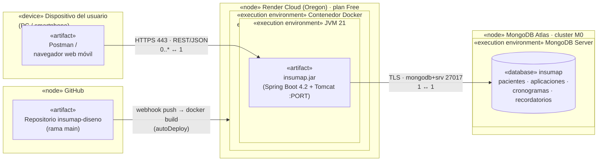
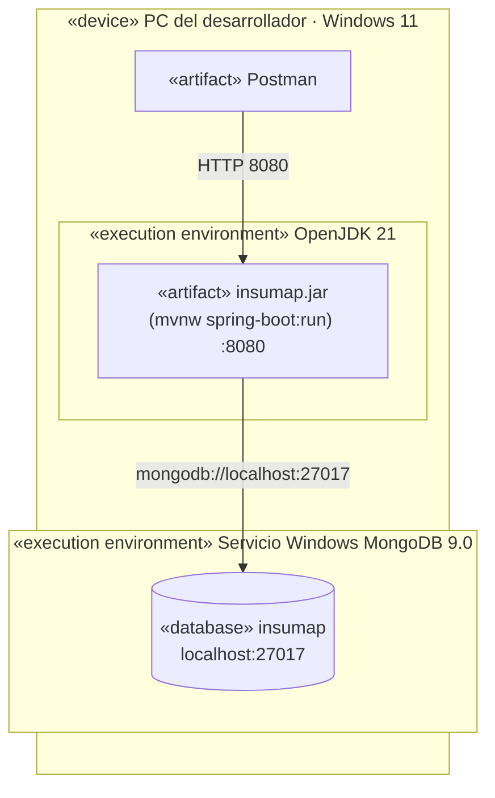

# 5. Vista de despliegue

Describe **dónde se ejecuta** cada pieza: nodos físicos o virtuales, entornos de ejecución, artefactos
desplegados y rutas de comunicación con sus protocolos.

## 5.1 Diagrama de despliegue – Producción

## 5.2 Diagrama de despliegue – Desarrollo local

## 5.3 Especificación de nodos y artefactos

| Nodo / entorno | Tipo UML | Especificación | Artefactos |
|---|---|---|---|
| Dispositivo del usuario | `«device»` | PC o smartphone con navegador o Postman | Colección `Insumap.postman_collection.json` |
| Render Cloud | `«node»` | Web Service Docker, plan Free, 512 MB RAM, HTTPS gestionado | – |
| Contenedor Docker | `«execution environment»` | Imagen multi-etapa `eclipse-temurin:21-jre`, usuario sin privilegios | `Dockerfile` |
| JVM 21 | `«execution environment»` | `-XX:MaxRAMPercentage=75 -XX:+UseSerialGC` | `insumap.jar` |
| MongoDB Atlas | `«node»` | Cluster M0 compartido, 512 MB, réplica de 3 nodos, TLS obligatorio | Base de datos `insumap` |
| GitHub | `«node»` | Repositorio público y disparador del despliegue | Código fuente, `render.yaml` |

| Ruta de comunicación | Protocolo | Multiplicidad |
|---|---|---|
| Dispositivo → insumap.jar | HTTPS (443), REST/JSON | `0..*` clientes a `1` servicio |
| insumap.jar → MongoDB Atlas | MongoDB Wire Protocol sobre TLS (`mongodb+srv`) | `1` a `1` |
| GitHub → Render | Webhook HTTPS (build automático) | `1` a `1` |

## Guía para Visual Paradigm

*Diagram → New → Deployment Diagram.* Nombre sugerido: `05-despliegue.png`.

1. Herramienta **Node** para `Dispositivo del usuario` (estereotipo `«device»`), `Render Cloud`, `MongoDB Atlas` y `GitHub`.
2. **Dentro** de `Render Cloud`, un **Node** con el estereotipo `«execution environment»` llamado `Contenedor Docker`. Dentro de él, otro `«execution environment»` llamado `JVM 21`.
3. Dentro de `JVM 21`, un **Artifact** `insumap.jar`. Dentro de `MongoDB Atlas`, un `«execution environment» MongoDB Server` con un **Artifact** `insumap` (estereotipo `«database»`). En el dispositivo, un **Artifact** `Postman`.
4. Une los nodos con **Communication Path** (línea continua). Ponle el protocolo como estereotipo, por ejemplo `«HTTPS»` o `«TLS/mongodb+srv»`, y multiplicidad en los extremos:

| Desde | Hacia | Estereotipo | Multiplicidad |
|---|---|---|---|
| Dispositivo del usuario | Render Cloud | `«HTTPS»` | 0..* – 1 |
| Render Cloud | MongoDB Atlas | `«TLS mongodb+srv»` | 1 – 1 |
| GitHub | Render Cloud | `«webhook»` | 1 – 1 |

5. Opcional: un **Artifact** `Dockerfile` fuera de los nodos, con una **Dependency** `«manifest»` hacia `insumap.jar`.
6. Repite los pasos en un segundo diagrama para el entorno local (5.2).
