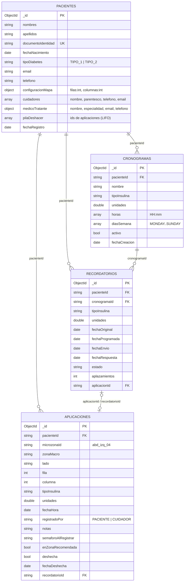

# Modelo de datos en MongoDB

Base de datos: `insumap`. Cuatro colecciones. Los subdocumentos **embebidos** (configuración del mapa,
cuidadores, médico y pila de deshacer) viven dentro del paciente. Las colecciones relacionadas se
**referencian** por `pacienteId`.



## Índices

| Colección | Índice | Tipo | Para qué |
|---|---|---|---|
| `pacientes` | `documentoIdentidad` | único | Evita pacientes duplicados |
| `aplicaciones` | `{pacienteId: 1, fechaHora: -1}` | compuesto | Historial y motor (consultas por paciente y fecha) |
| `cronogramas` | `pacienteId` | simple | Cronogramas del paciente |
| `recordatorios` | `{cronogramaId: 1, fechaOriginal: 1}` | compuesto único | Generación idempotente: no duplica un recordatorio de la misma dosis |

## Ejemplo de documentos

```json
// pacientes
{
  "_id": { "$oid": "6b03181025370ed951e46f37" },
  "nombres": "Ana Maria",
  "apellidos": "Gomez Rojas",
  "documentoIdentidad": "1001234567",
  "fechaNacimiento": { "$date": "1990-05-10T00:00:00Z" },
  "tipoDiabetes": "TIPO_1",
  "configuracionMapa": { "filas": 3, "columnas": 4 },
  "cuidadores": [ { "nombre": "Luis Gomez", "parentesco": "Hermano" } ],
  "medicoTratante": { "nombre": "Dra. Laura Perez", "especialidad": "Endocrinologia" },
  "pilaDeshacer": [ "6b03181a25370ed951e46f39" ],
  "fechaRegistro": { "$date": "2026-11-22T16:28:00Z" },
  "_class": "co.edu.ucc.insumap.modelo.Paciente"
}

// aplicaciones
{
  "_id": { "$oid": "6b03181a25370ed951e46f39" },
  "pacienteId": "6b03181025370ed951e46f37",
  "microzonaId": "abd_izq_04",
  "zonaMacro": "ABDOMEN", "lado": "IZQUIERDO", "fila": 0, "columna": 3,
  "tipoInsulina": "RAPIDA", "unidades": 6.0,
  "fechaHora": { "$date": "2026-11-22T16:28:10Z" },
  "registradoPor": "PACIENTE",
  "semaforoAlRegistrar": "VERDE",
  "enZonaRecomendada": false,
  "deshecha": false
}
```

## Cómo ver los datos

- **MongoDB Compass**, conectado a `mongodb://localhost:27017`, base de datos `insumap`.
- **mongosh**: `use insumap; db.aplicaciones.find({ pacienteId: "<id>" }).sort({ fechaHora: -1 })`
