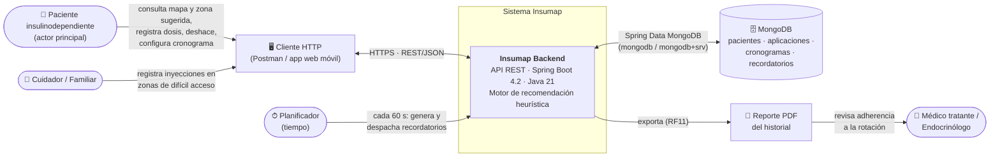

> Página generada desde `diagramas/01-vista-contexto.md` del repositorio (https://github.com/Drako2305/insumap-diseno/blob/main/diagramas/01-vista-contexto.md).

# 1. Vista de contexto

Muestra a Insumap como una caja negra: quién lo usa, con qué sistemas externos se comunica y qué
información intercambia. Es el límite del sistema.

## Diagrama de contexto

## Elementos del contexto

| Elemento | Tipo | Responsabilidad / interacción |
|---|---|---|
| Paciente insulinodependiente | Actor principal (humano) | Consulta el mapa y la zona sugerida, registra y deshace inyecciones, configura el cronograma y responde recordatorios. |
| Cuidador / Familiar | Actor (humano) | Registra inyecciones en nombre del paciente (`registradoPor = CUIDADOR`). |
| Médico tratante | Actor secundario (humano) | No usa la API directamente: recibe el PDF exportado por el paciente y evalúa la adherencia. |
| Planificador (tiempo) | Actor temporal | Dispara cada 60 s el ciclo de recordatorios (`PlanificadorRecordatorios`). |
| Cliente HTTP | Sistema externo | Postman en la entrega; una app web móvil en el futuro. |
| MongoDB | Sistema externo (base de datos) | Persiste las 4 colecciones del sistema. |

## Guía para Visual Paradigm

**Tipo de diagrama:** *Diagram → New → Use Case Diagram*, usado como diagrama de contexto. También sirve
*Requirements → System Context Diagram* si tu edición de VP lo incluye. Nombre sugerido: `01-contexto.png`.

1. Dibuja un **System** (rectángulo) llamado `Insumap Backend` con el estereotipo `«system»`.
2. Agrega cuatro **Actor**: `Paciente`, `Cuidador`, `Medico tratante` y `Planificador`. Al último ponle el estereotipo `«timer»`.
3. Agrega dos actores con el estereotipo `«system»` para los sistemas externos: `MongoDB` y `Cliente HTTP (Postman)`.
4. Conecta con **Association**, sin flechas de herencia, y pon en cada línea el nombre de lo que se intercambia:

| Desde | Hacia | Relación | Etiqueta | Multiplicidad (desde – hacia) |
|---|---|---|---|---|
| Paciente | Cliente HTTP | Association | usa | `1` – `1..*` |
| Cuidador | Cliente HTTP | Association | usa | `0..*` – `1..*` |
| Cliente HTTP | Insumap Backend | Association | HTTPS REST/JSON | `0..*` – `1` |
| Planificador | Insumap Backend | Association | dispara ciclo cada 60 s | `1` – `1` |
| Insumap Backend | MongoDB | Association | lee/escribe documentos | `1` – `1` |
| Médico tratante | Insumap Backend | Association | recibe reporte PDF | `0..*` – `1` |

5. Agrega una **Note** con el texto: *"Datos de salud sensibles: la exportación la controla el paciente."*
