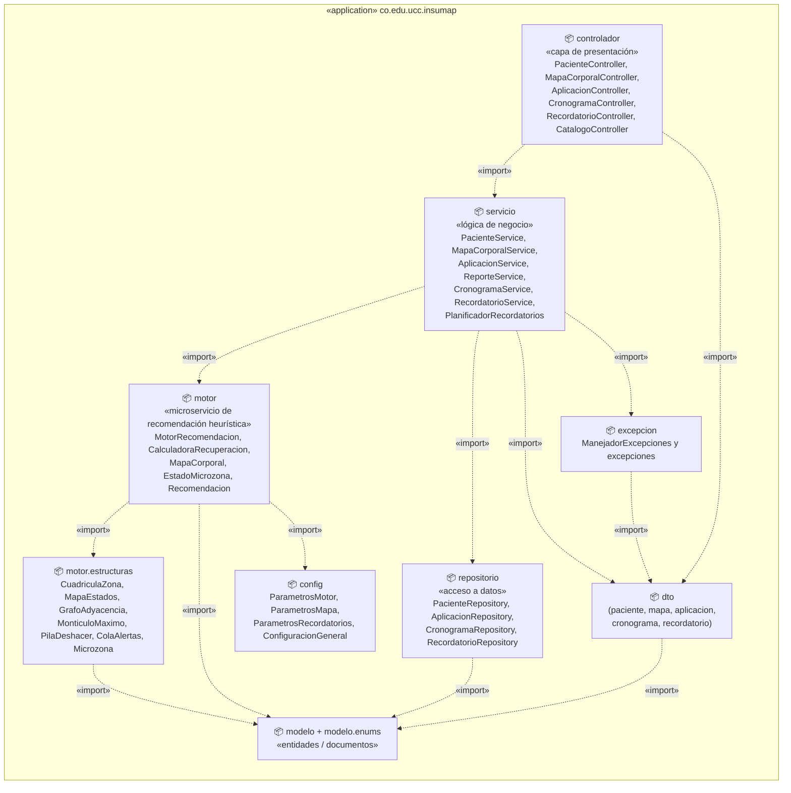
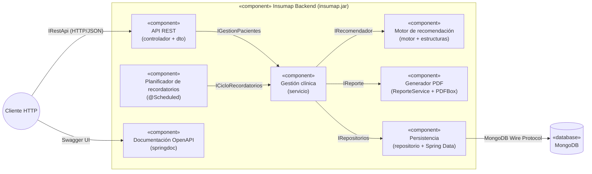

> Página generada desde `diagramas/04-vista-desarrollo.md` del repositorio (https://github.com/Drako2305/insumap-diseno/blob/main/diagramas/04-vista-desarrollo.md).

# 4. Vista de desarrollo

Describe **cómo está organizado el código fuente**: paquetes, capas, dependencias permitidas,
librerías y estructura del proyecto Maven. Responde al atributo de calidad de **escalabilidad modular**:
separar la interfaz (API), la lógica de negocio y el motor de recomendación.

## 4.1 Diagrama de paquetes



**Reglas de dependencia**

| Regla | Motivo |
|---|---|
| `controlador` solo conoce `servicio` y `dto`, nunca `repositorio` | La API no accede a la base de datos directamente. |
| `motor` **no** depende de `repositorio`, `servicio` ni de Spring Web | El motor es puro y se prueba sin base de datos. Se puede extraer a un microservicio o reutilizar en el cliente (requisito de < 200 ms en el dispositivo). |
| `modelo` no depende de ningún paquete propio | Las entidades son la base y no conocen a nadie. |
| `dto` desacopla el formato JSON de los documentos de MongoDB | Se puede cambiar la API sin migrar datos. |

## 4.2 Diagrama de componentes



## 4.3 Librerías (dependencias Maven)

| Librería | Versión | Uso |
|---|---|---|
| `spring-boot-starter-webmvc` | 4.2.0 | API REST, Tomcat embebido |
| `spring-boot-starter-data-mongodb` | 4.2.0 | Repositorios y mapeo de documentos |
| `spring-boot-starter-validation` | 4.2.0 | Validación de DTO (`@NotBlank`, `@DecimalMin`, `@Pattern`) |
| `spring-boot-starter-actuator` | 4.2.0 | `/actuator/health` para el despliegue |
| `springdoc-openapi-starter-webmvc-ui` | 3.2.1 | Swagger UI y contrato OpenAPI |
| `pdfbox` | 3.0.8 | Exportación del historial en PDF (RF11) |
| `spring-boot-starter-*-test` (JUnit 5, Mockito, AssertJ, MockMvc) | 4.2.0 | Pruebas |

## 4.4 Estructura del proyecto

```
insumap-diseno/
├── pom.xml                         # Maven: Java 21, Spring Boot 4.2
├── mvnw, mvnw.cmd                  # Maven Wrapper (no requiere instalar Maven)
├── Dockerfile, render.yaml         # Despliegue
├── src/main/java/co/edu/ucc/insumap/
│   ├── InsumapApplication.java
│   ├── config/
│   ├── controlador/
│   ├── dto/{paciente,mapa,aplicacion,cronograma,recordatorio}/
│   ├── excepcion/
│   ├── modelo/ y modelo/enums/
│   ├── motor/ y motor/estructuras/
│   ├── repositorio/
│   └── servicio/
├── src/main/resources/application.properties
├── src/test/java/...               # 24 pruebas (motor, estructuras, controlador)
├── postman/                        # Colección y entornos
├── diagramas/                      # Este material
├── wiki/                           # Páginas de la wiki
└── despliegue/                     # Guía de despliegue
```

## Guía para Visual Paradigm

### Diagrama de paquetes (`04-paquetes.png`)

*Diagram → New → Package Diagram.*

1. Un **Package** contenedor `co.edu.ucc.insumap` y, dentro, un **Package** por cada carpeta: `controlador`, `dto`, `servicio`, `motor`, `motor.estructuras` (anidado en `motor`), `repositorio`, `modelo`, `config` y `excepcion`.
2. Opcional: dentro de cada paquete, arrastra las clases del diagrama de clases. VP las enlaza al modelo.
3. Relaciones con **Dependency** y el estereotipo `«import»`, como en la tabla:

| Desde | Hacia |
|---|---|
| controlador | servicio, dto |
| servicio | motor, repositorio, dto, excepcion |
| motor | motor.estructuras, modelo, config |
| motor.estructuras | modelo |
| repositorio | modelo |
| dto | modelo |
| excepcion | dto |

4. Agrega un paquete externo `org.springframework` y otro `org.apache.pdfbox` con el estereotipo `«library»`, y dependencias `«use»` desde `controlador`, `repositorio` y `servicio`.

### Diagrama de componentes (`04-componentes.png`)

*Diagram → New → Component Diagram.*

1. Un **Component** contenedor `Insumap Backend` con el estereotipo `«subsystem»`. Dentro, los 7 componentes del diagrama 4.2.
2. Interfaces: para cada interfaz (`IRestApi`, `IGestionPacientes`, `IRecomendador`, `IReporte`, `IRepositorios`, `ICicloRecordatorios`), el que la ofrece lleva una **Provided Interface** (*lollipop*) y el que la usa una **Required Interface** (*socket*). Únelos con **Assembly Connector**.

| Componente que ofrece | Interfaz | Componente que requiere |
|---|---|---|
| API REST | IRestApi | Cliente HTTP (externo) |
| Gestión clínica | IGestionPacientes | API REST |
| Motor de recomendación | IRecomendador | Gestión clínica |
| Generador PDF | IReporte | Gestión clínica |
| Persistencia | IRepositorios | Gestión clínica |
| Gestión clínica | ICicloRecordatorios | Planificador de recordatorios |

3. Un **Port** en `Insumap Backend` hacia `MongoDB` (componente externo con el estereotipo `«database»`).
