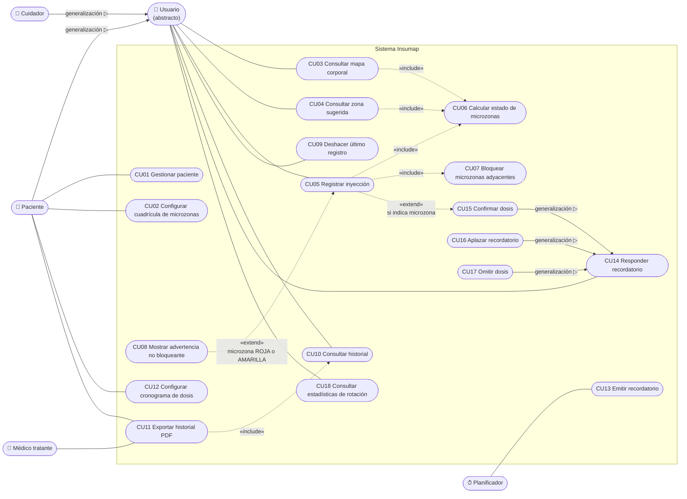
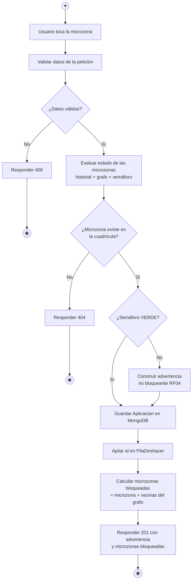

> Página generada desde `diagramas/02-vista-funcional.md` del repositorio (https://github.com/Drako2305/insumap-diseno/blob/main/diagramas/02-vista-funcional.md).

# 2. Vista funcional

Describe **qué hace** el sistema desde el punto de vista de los actores: casos de uso, sus relaciones
`«include»` / `«extend»`, la generalización de actores y la especificación de los casos principales.

## 2.1 Diagrama de casos de uso

## 2.2 Catálogo de casos de uso y trazabilidad

| ID | Caso de uso | Actor(es) | Requisito | Endpoint |
|---|---|---|---|---|
| CU01 | Gestionar paciente (crear, consultar, actualizar, eliminar) | Paciente | – | `POST/GET/PUT/DELETE /api/pacientes` |
| CU02 | Configurar cuadrícula de microzonas | Paciente | RF02 | `PUT /api/pacientes/{id}/configuracion-mapa` |
| CU03 | Consultar mapa corporal | Usuario | RF01, RF06 | `GET /api/pacientes/{id}/mapa` |
| CU04 | Consultar zona sugerida | Usuario | RF08, RF09 | `GET /api/pacientes/{id}/recomendacion` |
| CU05 | Registrar inyección | Usuario | RF03, RF07 | `POST /api/pacientes/{id}/aplicaciones` |
| CU06 | Calcular estado de microzonas | (incluido) | RF06, RF08 | `MotorRecomendacion.evaluar` |
| CU07 | Bloquear microzonas adyacentes | (incluido) | RF07 | Grafo de adyacencia |
| CU08 | Mostrar advertencia no bloqueante | (extensión) | RF04 | `GET .../aplicaciones/validar/{microzonaId}` |
| CU09 | Deshacer último registro | Usuario | RF05 | `POST .../aplicaciones/deshacer` |
| CU10 | Consultar historial | Usuario | RF11 | `GET .../aplicaciones` |
| CU11 | Exportar historial PDF | Paciente, Médico | RF11 | `GET .../aplicaciones/exportar/pdf` |
| CU12 | Configurar cronograma de dosis | Paciente | RF10 | `/api/pacientes/{id}/cronogramas` |
| CU13 | Emitir recordatorio | Planificador | RF10 | `PlanificadorRecordatorios` / `POST /api/recordatorios/procesar` |
| CU14 | Responder recordatorio (abstracto) | Usuario | RF10 | – |
| CU15 | Confirmar dosis | Usuario | RF10 | `POST /api/recordatorios/{id}/confirmar` |
| CU16 | Aplazar recordatorio | Usuario | RF10 | `POST /api/recordatorios/{id}/aplazar` |
| CU17 | Omitir dosis | Usuario | RF10 | `POST /api/recordatorios/{id}/omitir` |
| CU18 | Consultar estadísticas de rotación | Usuario | RF09 | `GET /api/pacientes/{id}/estadisticas` |

## 2.3 Especificación de casos de uso principales

### CU05 – Registrar inyección

| Campo | Descripción |
|---|---|
| **Actor principal** | Usuario (Paciente o Cuidador) |
| **Precondición** | El paciente existe y la microzona pertenece a su cuadrícula. |
| **Disparador** | El usuario toca una microzona del mapa (registro en un solo toque). |
| **Flujo básico** | 1. El usuario envía `microzonaId`, `tipoInsulina` y `unidades`. 2. El sistema calcula el estado actual de las microzonas (CU06). 3. La microzona está en VERDE. 4. El sistema guarda la aplicación con `semaforoAlRegistrar = VERDE` y marca si coincide con la zona sugerida. 5. El sistema apila el id en la pila de deshacer. 6. El sistema devuelve la microzona y sus adyacentes, ahora bloqueadas en ROJO (CU07). |
| **Flujo alterno 3a** | La microzona está en ROJO o AMARILLO: se ejecuta CU08 y se devuelve la advertencia **sin bloquear** el registro (RF04). Continúa en el paso 4. |
| **Excepciones** | E1: el paciente no existe → 404. E2: la microzona no existe → 404. E3: la fecha está en el futuro → 400. E4: datos inválidos → 400. |
| **Postcondición** | La microzona y sus vecinas quedan en ROJO. La recomendación se recalcula en la siguiente consulta. |

### CU04 – Consultar zona sugerida

| Campo | Descripción |
|---|---|
| **Actor principal** | Usuario |
| **Flujo básico** | 1. El sistema carga el historial de los últimos 60 días. 2. Calcula para cada microzona las horas de recuperación según la zona y la frecuencia de uso (RF08). 3. Aplica el bloqueo por adyacencia (RF07). 4. Calcula el uso por zona macro: penaliza las zonas cuyo uso supera el promedio en 30 días (×0,6) y prioriza las que no se usan hace 15 días o más (×1,5) (RF09). 5. Inserta todas las microzonas en un Max-Heap ordenado por (semáforo, puntaje) y extrae la raíz. 6. Devuelve la microzona sugerida, el motivo, 3 alternativas y el tiempo de cálculo (< 200 ms). |
| **Flujo alterno 5a** | Ninguna microzona está en VERDE: se sugiere la de mayor recuperación con `hayZonasOptimas = false`. |

### CU09 – Deshacer último registro

| Campo | Descripción |
|---|---|
| **Actor principal** | Usuario |
| **Flujo básico** | 1. El sistema reconstruye la pila LIFO del paciente. 2. Desapila el id de la cima. 3. Marca la aplicación como `deshecha = true`. 4. Guarda la pila. 5. Devuelve la aplicación deshecha y las microzonas restablecidas. |
| **Flujo alterno 2a** | La pila está vacía → 409 "No hay registros de inyección para deshacer". |

### CU13 / CU14 – Emitir y responder recordatorio

| Campo | Descripción |
|---|---|
| **Actor principal** | Planificador (CU13), Usuario (CU14) |
| **Flujo básico** | 1. Cada 60 s el planificador crea los recordatorios de las próximas 24 h a partir de los cronogramas activos. 2. Los recordatorios vencidos se encolan en una cola FIFO en orden cronológico. 3. Se desencolan y se marcan como ENVIADO. 4. El usuario confirma (CU15), aplaza (CU16) u omite (CU17). |
| **Reglas** | Máximo 3 aplazamientos. Por defecto se aplaza 15 minutos. Un recordatorio ya respondido no admite otra respuesta (409). |

## 2.4 Diagrama de actividad – Registrar inyección

## Guía para Visual Paradigm

### Diagrama de casos de uso (`02-casos-de-uso.png`)

*Diagram → New → Use Case Diagram.*

1. **System** (rectángulo) llamado `Sistema Insumap`. Dentro, un **Use Case** (elipse) por cada fila del catálogo (CU01 a CU18).
2. Actores fuera del sistema: `Usuario` (márcalo **Abstract**, en cursiva), `Paciente`, `Cuidador`, `Medico tratante` y `Planificador` (con el estereotipo `«timer»`).
3. Relaciones:

| Desde | Hacia | Herramienta VP | Notas |
|---|---|---|---|
| Paciente | Usuario | **Generalization** (triángulo vacío apunta a Usuario) | Herencia de actores |
| Cuidador | Usuario | **Generalization** | Herencia de actores |
| Paciente | CU01, CU02, CU11, CU12 | **Association** | Línea continua sin flecha |
| Usuario | CU03, CU04, CU05, CU09, CU10, CU14, CU18 | **Association** | |
| Medico tratante | CU11 | **Association** | Actor secundario |
| Planificador | CU13 | **Association** | |
| CU03, CU04, CU05 | CU06 | **Include** | La flecha va **del base al incluido** |
| CU05 | CU07 | **Include** | |
| CU11 | CU10 | **Include** | |
| CU08 | CU05 | **Extend** | La flecha va **del que extiende al base**. Extension point en CU05: `Microzona no recuperada` |
| CU05 | CU15 | **Extend** | Extension point en CU15: `Se indicó microzona` |
| CU15, CU16, CU17 | CU14 | **Generalization** | CU14 abstracto (cursiva) |

### Diagrama de actividad (`02-actividad-registrar.png`)

*Diagram → New → Activity Diagram.* Usa **Initial Node**, **Action**, **Decision Node**, **Merge Node** y
**Activity Final Node**, siguiendo el diagrama 2.4. Pon guardas en las salidas de cada decisión, por ejemplo `[sí]` y `[no]`.
Si quieres, separa las acciones en dos **Partition** (*swimlanes*): `Usuario` y `Sistema Insumap`.
