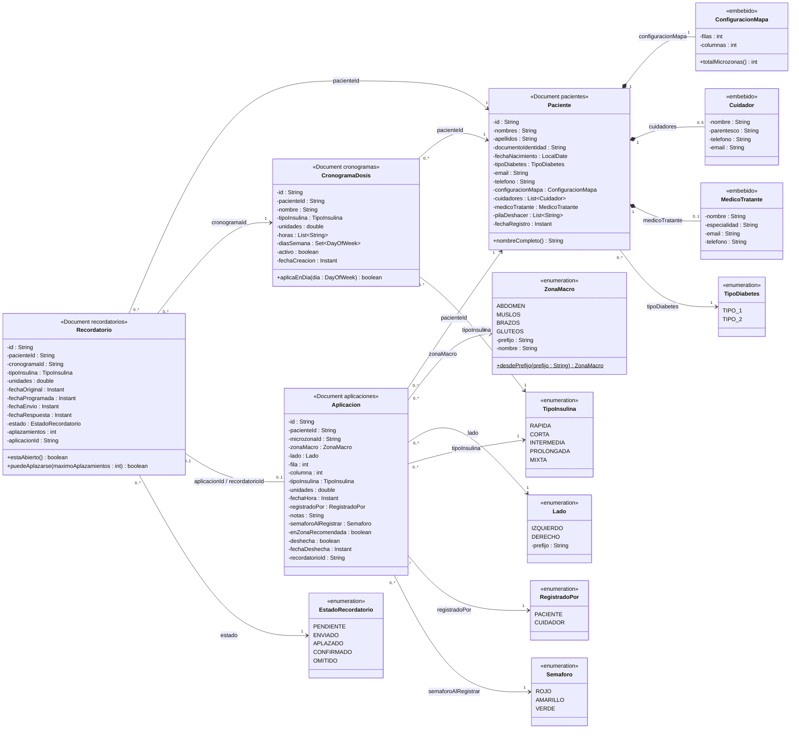
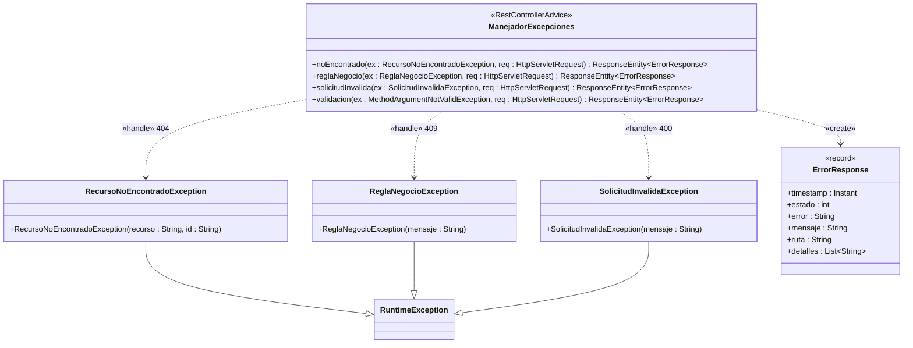
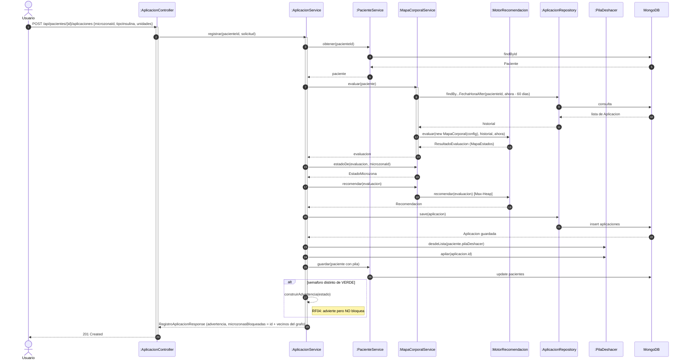
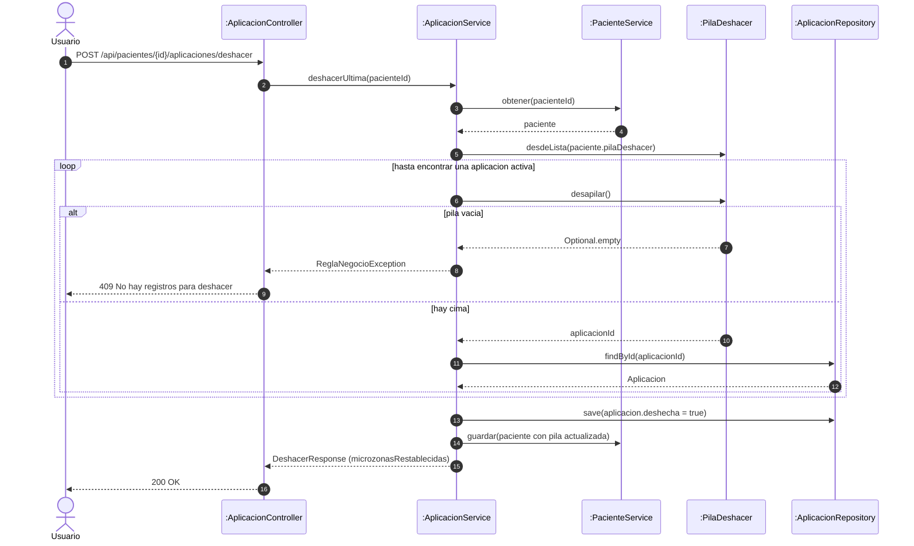
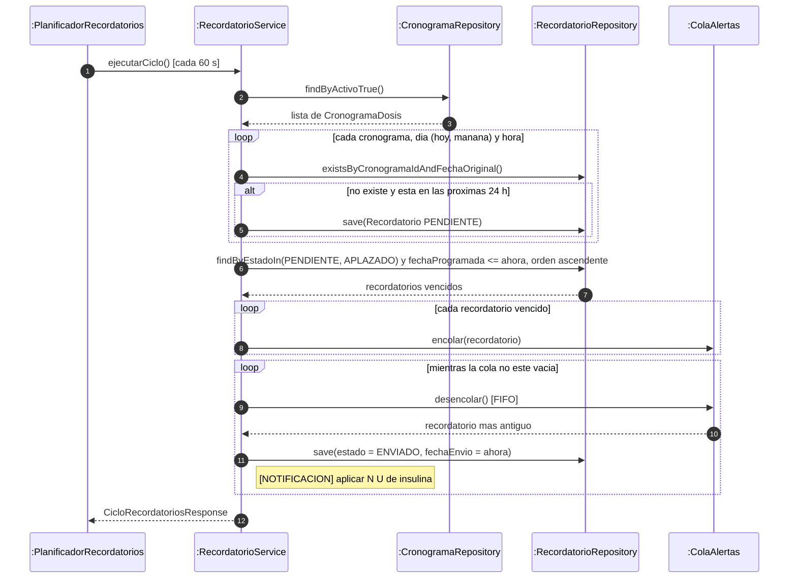
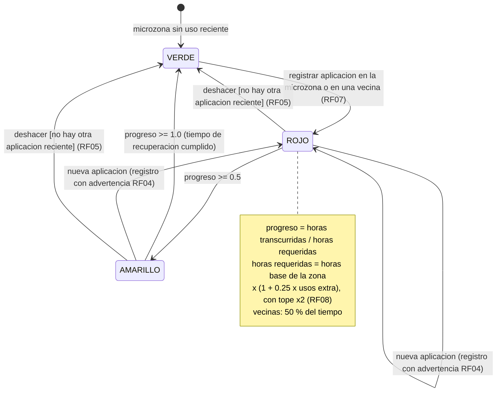
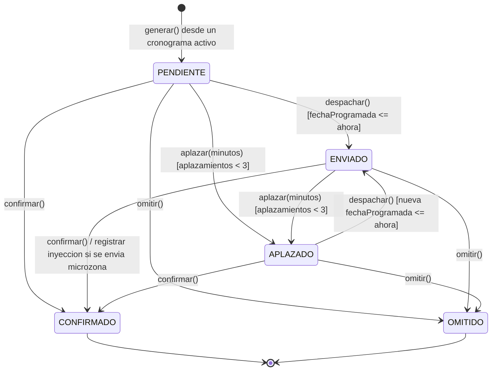

> Página generada desde `diagramas/03-vista-logica.md` del repositorio (https://github.com/Drako2305/insumap-diseno/blob/main/diagramas/03-vista-logica.md).

# 3. Vista lógica

Describe la **estructura interna**: clases, atributos tipados, métodos, relaciones con su multiplicidad y
el comportamiento dinámico (secuencia y estados). Los diagramas reflejan exactamente el código de
`src/main/java/co/edu/ucc/insumap`.

Para no saturar un solo diagrama, el diagrama de clases se divide en tres:

| Diagrama | Contenido |
|---|---|
| 3.1 | Modelo de dominio (documentos de MongoDB y enumeraciones) |
| 3.2 | Motor de recomendación y estructuras de datos |
| 3.3 | Capas de controladores, servicios y repositorios |
| 3.4 | Secuencia: registrar inyección |
| 3.5 | Secuencia: deshacer último registro |
| 3.6 | Secuencia: ciclo de recordatorios (cola FIFO) |
| 3.7 | Máquina de estados de la microzona (semáforo) |
| 3.8 | Máquina de estados del recordatorio |

> Los *getters* y *setters* se omiten en los diagramas para facilitar la lectura. Todos los atributos son privados (`-`)
> y tienen sus métodos `get`/`set` públicos.

---

## 3.1 Diagrama de clases – Modelo de dominio

**Justificación de las relaciones**

| Relación | Tipo | Por qué |
|---|---|---|
| Paciente ◆— ConfiguracionMapa, Cuidador, MedicoTratante | Composición | Son **subdocumentos embebidos** en el documento `pacientes`: no tienen identidad ni colección propia y se eliminan con el paciente. |
| Aplicacion, CronogramaDosis, Recordatorio → Paciente | Asociación dirigida `0..*` a `1` | Son colecciones independientes que **referencian** al paciente por `pacienteId`. Un paciente tiene cero o muchas. Al eliminar el paciente se borran en cascada desde `PacienteService.eliminar`. |
| Recordatorio → CronogramaDosis | Asociación `0..*` a `1` | Cada recordatorio nace de un cronograma, que genera muchos recordatorios. |
| Recordatorio — Aplicacion | Asociación bidireccional `0..1` a `0..1` | Al confirmar un recordatorio con microzona se crea la aplicación. Ambos guardan el id del otro. |
| Clases → enumeraciones | Asociación `0..*` a `1` | Cada documento tiene exactamente un valor del enum. |

---

## 3.2 Diagrama de clases – Motor de recomendación y estructuras de datos

```mermaid
classDiagram
    direction TB

    class ParametrosMotor {
        <<record>>
        +horasBaseAbdomen : double
        +horasBaseMuslos : double
        +horasBaseBrazos : double
        +horasBaseGluteos : double
        +factorFrecuencia : double
        +factorFrecuenciaMaximo : double
        +factorAdyacencia : double
        +umbralRojo : double
        +diasVentana : int
        +diasZonaOlvidada : int
        +penalizacionZonaSaturada : double
        +bonificacionZonaOlvidada : double
        +alternativas : int
        +porDefecto()$ ParametrosMotor
        +horasBase(zona : ZonaMacro) double
    }

    class CalculadoraRecuperacion {
        <<Component>>
        -parametros : ParametrosMotor
        +horasRecuperacion(zona : ZonaMacro, usosEnVentana : int) double
        +horasBloqueoAdyacente(zona : ZonaMacro, usosEnVentana : int) double
        +progreso(horasTranscurridas : double, horasRequeridas : double) double
        +semaforo(progreso : double) Semaforo
    }

    class MotorRecomendacion {
        <<Component>>
        -HORAS_POR_DIA : double$
        -parametros : ParametrosMotor
        -calculadora : CalculadoraRecuperacion
        +diasHistorialRequeridos() int
        +evaluar(mapa : MapaCorporal, historial : List~Aplicacion~, ahora : Instant) ResultadoEvaluacion
        +recomendar(evaluacion : ResultadoEvaluacion) Recomendacion
        -construirMotivo(candidato : CandidatoRecomendacion, evaluacion : ResultadoEvaluacion, hayOptimas : boolean) String
    }

    class MapaCorporal {
        -filas : int
        -columnas : int
        -cuadriculas : Map~String, CuadriculaZona~
        -indice : Map~String, Microzona~
        -grafo : GrafoAdyacencia
        +MapaCorporal(configuracion : ConfiguracionMapa)
        +buscar(microzonaId : String) Optional~Microzona~
        +existe(microzonaId : String) boolean
        +vecinos(microzonaId : String) Set~String~
        +cuadricula(zona : ZonaMacro, lado : Lado) CuadriculaZona
        +todas() List~Microzona~
        +totalMicrozonas() int
        -conectarVecinosInternos(cuadricula : CuadriculaZona) void
        -conectarLineaMediaAbdomen() void
    }

    class CuadriculaZona {
        <<Matriz 2D>>
        -zonaMacro : ZonaMacro
        -lado : Lado
        -celdas : Microzona[][]
        +obtener(fila : int, columna : int) Microzona
        +enRango(fila : int, columna : int) boolean
        +todas() List~Microzona~
        +getFilas() int
        +getColumnas() int
    }

    class Microzona {
        <<record>>
        +id : String
        +zonaMacro : ZonaMacro
        +lado : Lado
        +fila : int
        +columna : int
        +crear(zona : ZonaMacro, lado : Lado, fila : int, columna : int, columnas : int)$ Microzona
        +construirId(zona : ZonaMacro, lado : Lado, fila : int, columna : int, columnas : int)$ String
        +claveCuadricula() String
    }

    class GrafoAdyacencia {
        <<Grafo no dirigido>>
        -adyacencias : Map~String, Set~
        +agregarNodo(nodo : String) void
        +agregarArista(a : String, b : String) void
        +vecinos(nodo : String) Set~String~
        +sonAdyacentes(a : String, b : String) boolean
        +contieneNodo(nodo : String) boolean
        +cantidadNodos() int
        +cantidadAristas() int
    }

    class MapaEstados {
        <<Tabla hash>>
        -estados : Map~String, EstadoMicrozona~
        +actualizar(estado : EstadoMicrozona) void
        +obtener(microzonaId : String) Optional~EstadoMicrozona~
        +todos() Collection~EstadoMicrozona~
        +contar(semaforo : Semaforo) long
        +tamano() int
    }

    class EstadoMicrozona {
        -microzona : Microzona
        -semaforo : Semaforo
        -progresoRecuperacion : double
        -horasDescanso : double
        -horasRecuperacionRequeridas : double
        -usosEnVentana : int
        -ultimaAplicacion : Instant
        -disponibleDesde : Instant
        -bloqueadaPorAdyacencia : boolean
        -origenBloqueo : String
        +estaDisponible() boolean
    }

    class ResumenZonaMacro {
        <<record>>
        +zona : ZonaMacro
        +usosEnVentana : int
        +diasSinUso : double
        +saturada : boolean
        +olvidada : boolean
        +factorPrioridad : double
    }

    class ResultadoEvaluacion {
        <<record>>
        +mapa : MapaCorporal
        +estados : MapaEstados
        +resumenZonas : Map~ZonaMacro, ResumenZonaMacro~
        +promedioUsosPorZona : double
        +evaluadoEn : Instant
    }

    class CandidatoRecomendacion {
        <<record>>
        +estado : EstadoMicrozona
        +puntaje : double
        +nivel() int
    }

    class Recomendacion {
        <<record>>
        +principal : CandidatoRecomendacion
        +alternativas : List~CandidatoRecomendacion~
        +zonasSaturadas : List~ZonaMacro~
        +zonasOlvidadas : List~ZonaMacro~
        +hayZonasOptimas : boolean
        +motivo : String
        +tiempoCalculoMs : double
    }

    class MonticuloMaximo~T~ {
        <<Max-Heap>>
        -elementos : List~T~
        -comparador : Comparator~T~
        +insertar(elemento : T) void
        +verMaximo() T
        +extraerMaximo() T
        +tamano() int
        +estaVacio() boolean
        -subir(indice : int) void
        -bajar(indice : int) void
        -intercambiar(i : int, j : int) void
    }

    class PilaDeshacer {
        <<Pila LIFO>>
        +CAPACIDAD_POR_DEFECTO : int$
        -pila : Deque~String~
        -capacidad : int
        +desdeLista(persistida : List~String~)$ PilaDeshacer
        +apilar(aplicacionId : String) void
        +desapilar() Optional~String~
        +cima() Optional~String~
        +estaVacia() boolean
        +tamano() int
        +aLista() List~String~
    }

    class ColaAlertas~T~ {
        <<Cola FIFO>>
        -cola : Queue~T~
        +encolar(alerta : T) void
        +desencolar() Optional~T~
        +frente() Optional~T~
        +tamano() int
        +estaVacia() boolean
    }

    MotorRecomendacion "1" --> "1" ParametrosMotor : parametros
    MotorRecomendacion "1" --> "1" CalculadoraRecuperacion : calculadora
    CalculadoraRecuperacion "1" --> "1" ParametrosMotor : parametros
    MotorRecomendacion ..> MapaCorporal : «use»
    MotorRecomendacion ..> ResultadoEvaluacion : «create»
    MotorRecomendacion ..> Recomendacion : «create»
    MotorRecomendacion ..> MonticuloMaximo : «create» T = CandidatoRecomendacion

    MapaCorporal "1" *-- "8" CuadriculaZona : cuadriculas
    MapaCorporal "1" *-- "1" GrafoAdyacencia : grafo
    MapaCorporal "1" o-- "1..*" Microzona : indice
    CuadriculaZona "1" *-- "1..*" Microzona : celdas

    ResultadoEvaluacion "0..*" --> "1" MapaCorporal : mapa
    ResultadoEvaluacion "1" *-- "1" MapaEstados : estados
    ResultadoEvaluacion "1" *-- "4" ResumenZonaMacro : resumenZonas
    MapaEstados "1" *-- "0..*" EstadoMicrozona : estados
    EstadoMicrozona "0..*" --> "1" Microzona : microzona

    Recomendacion "1" *-- "1" CandidatoRecomendacion : principal
    Recomendacion "1" *-- "0..3" CandidatoRecomendacion : alternativas
    CandidatoRecomendacion "0..*" --> "1" EstadoMicrozona : estado
    MonticuloMaximo "1" o-- "0..*" CandidatoRecomendacion : elementos
```

**Justificación de las relaciones**

| Relación | Tipo | Por qué |
|---|---|---|
| MapaCorporal ◆— CuadriculaZona `1` a `8` | Composición | El mapa crea las 8 cuadrículas (4 zonas × 2 lados) y estas no existen fuera de él. |
| CuadriculaZona ◆— Microzona `1` a `1..*` | Composición | La matriz `Microzona[][]` crea y contiene las celdas (`filas × columnas`). |
| MapaCorporal ◇— Microzona `1` a `1..*` | Agregación | La tabla hash `indice` **comparte** las microzonas creadas por las cuadrículas para buscarlas en O(1); no es su dueña. |
| MapaCorporal ◆— GrafoAdyacencia | Composición | El grafo se construye dentro del mapa y modela su topología. |
| MapaEstados ◆— EstadoMicrozona | Composición | La tabla hash crea y guarda un estado por microzona en cada evaluación. |
| MonticuloMaximo ◇— CandidatoRecomendacion | Agregación | El heap ordena los candidatos, pero los candidatos extraídos pasan a la `Recomendacion`. |
| MotorRecomendacion → ParametrosMotor / CalculadoraRecuperacion | Asociación | Atributos inyectados por constructor. |
| MotorRecomendacion ⇢ MapaCorporal, ResultadoEvaluacion, Recomendacion, MonticuloMaximo | Dependencia | Los recibe como parámetro o los crea dentro de un método, sin guardarlos como atributo. |

**Estructuras de datos del caso de estudio**

| Estructura pedida | Clase | Complejidad |
|---|---|---|
| Matrices bidimensionales | `CuadriculaZona.celdas : Microzona[][]` | Acceso O(1) por (fila, columna) |
| Tablas hash | `MapaEstados.estados`, `MapaCorporal.indice` (`HashMap`) | Consulta y actualización O(1) |
| Grafo no dirigido | `GrafoAdyacencia` (listas de adyacencia) | Vecinos O(grado) |
| Cola de prioridad (Max-Heap) | `MonticuloMaximo<T>` (montículo binario propio) | Insertar y extraer O(log n) |
| Pila (LIFO) | `PilaDeshacer` (`ArrayDeque`) | Apilar y desapilar O(1) |
| Cola (FIFO) | `ColaAlertas<T>` (`ArrayDeque`) | Encolar y desencolar O(1) |

---

## 3.3 Diagrama de clases – Controladores, servicios y repositorios

```mermaid
classDiagram
    direction LR

    class PacienteController {
        <<RestController>>
        -pacienteService : PacienteService
        +crear(solicitud : PacienteRequest) ResponseEntity~PacienteResponse~
        +listar() List~PacienteResponse~
        +consultar(id : String) PacienteResponse
        +actualizar(id : String, solicitud : PacienteRequest) PacienteResponse
        +configurarMapa(id : String, solicitud : ConfiguracionMapaRequest) PacienteResponse
        +eliminar(id : String) ResponseEntity~Void~
    }
    class MapaCorporalController {
        <<RestController>>
        -mapaCorporalService : MapaCorporalService
        +mapa(pacienteId : String) MapaCorporalResponse
        +microzona(pacienteId : String, microzonaId : String) MicrozonaDetalleResponse
        +recomendacion(pacienteId : String) RecomendacionResponse
        +estadisticas(pacienteId : String) EstadisticasResponse
    }
    class AplicacionController {
        <<RestController>>
        -aplicacionService : AplicacionService
        -reporteService : ReporteService
        +validar(pacienteId : String, microzonaId : String) ValidacionAplicacionResponse
        +registrar(pacienteId : String, solicitud : RegistrarAplicacionRequest) ResponseEntity~RegistroAplicacionResponse~
        +deshacer(pacienteId : String) DeshacerResponse
        +historial(pacienteId : String, desde : Instant, hasta : Instant, zona : ZonaMacro) List~AplicacionResponse~
        +consultar(pacienteId : String, aplicacionId : String) AplicacionResponse
        +exportarPdf(pacienteId : String, desde : Instant, hasta : Instant) ResponseEntity~byte[]~
    }
    class CronogramaController {
        <<RestController>>
        -cronogramaService : CronogramaService
        +crear(pacienteId : String, solicitud : CronogramaRequest) ResponseEntity~CronogramaResponse~
        +listar(pacienteId : String) List~CronogramaResponse~
        +consultar(pacienteId : String, cronogramaId : String) CronogramaResponse
        +actualizar(pacienteId : String, cronogramaId : String, solicitud : CronogramaRequest) CronogramaResponse
        +cambiarEstado(pacienteId : String, cronogramaId : String, activo : boolean) CronogramaResponse
        +eliminar(pacienteId : String, cronogramaId : String) ResponseEntity~Void~
    }
    class RecordatorioController {
        <<RestController>>
        -recordatorioService : RecordatorioService
        +listar(pacienteId : String, estado : EstadoRecordatorio) List~RecordatorioResponse~
        +consultar(recordatorioId : String) RecordatorioResponse
        +confirmar(recordatorioId : String, solicitud : ConfirmarRecordatorioRequest) ConfirmacionRecordatorioResponse
        +aplazar(recordatorioId : String, solicitud : AplazarRecordatorioRequest) RecordatorioResponse
        +omitir(recordatorioId : String) RecordatorioResponse
        +procesar() CicloRecordatoriosResponse
    }

    class PacienteService {
        <<Service>>
        +crear(solicitud : PacienteRequest) PacienteResponse
        +listar() List~PacienteResponse~
        +consultar(id : String) PacienteResponse
        +obtener(id : String) Paciente
        +actualizar(id : String, solicitud : PacienteRequest) PacienteResponse
        +actualizarConfiguracion(id : String, solicitud : ConfiguracionMapaRequest) PacienteResponse
        +eliminar(id : String) void
        +guardar(paciente : Paciente) Paciente
    }
    class MapaCorporalService {
        <<Service>>
        +evaluar(paciente : Paciente) ResultadoEvaluacion
        +recomendar(evaluacion : ResultadoEvaluacion) Recomendacion
        +obtenerMapa(pacienteId : String) MapaCorporalResponse
        +obtenerMicrozona(pacienteId : String, microzonaId : String) MicrozonaDetalleResponse
        +obtenerRecomendacion(pacienteId : String) RecomendacionResponse
        +obtenerEstadisticas(pacienteId : String) EstadisticasResponse
        +estadoDe(evaluacion : ResultadoEvaluacion, microzonaId : String) EstadoMicrozona
    }
    class AplicacionService {
        <<Service>>
        -TOLERANCIA_FUTURO : Duration$
        +validar(pacienteId : String, microzonaId : String) ValidacionAplicacionResponse
        +registrar(pacienteId : String, solicitud : RegistrarAplicacionRequest, recordatorioId : String) RegistroAplicacionResponse
        +deshacerUltima(pacienteId : String) DeshacerResponse
        +historial(pacienteId : String, desde : Instant, hasta : Instant, zona : ZonaMacro) List~AplicacionResponse~
        +consultarHistorial(pacienteId : String, desde : Instant, hasta : Instant, zona : ZonaMacro) List~Aplicacion~
        +consultar(pacienteId : String, aplicacionId : String) AplicacionResponse
    }
    class ReporteService {
        <<Service>>
        +generarHistorialPdf(pacienteId : String, desde : Instant, hasta : Instant) byte[]
    }
    class CronogramaService {
        <<Service>>
        +crear(pacienteId : String, solicitud : CronogramaRequest) CronogramaResponse
        +listar(pacienteId : String) List~CronogramaResponse~
        +actualizar(pacienteId : String, cronogramaId : String, solicitud : CronogramaRequest) CronogramaResponse
        +cambiarEstado(pacienteId : String, cronogramaId : String, activo : boolean) CronogramaResponse
        +eliminar(pacienteId : String, cronogramaId : String) void
    }
    class RecordatorioService {
        <<Service>>
        -cola : ColaAlertas~Recordatorio~
        +ejecutarCiclo() CicloRecordatoriosResponse
        ~generar(ahora : Instant) int
        ~despachar(ahora : Instant) List~Recordatorio~
        +listar(pacienteId : String, estado : EstadoRecordatorio) List~RecordatorioResponse~
        +confirmar(recordatorioId : String, solicitud : ConfirmarRecordatorioRequest) ConfirmacionRecordatorioResponse
        +aplazar(recordatorioId : String, minutos : Integer) RecordatorioResponse
        +omitir(recordatorioId : String) RecordatorioResponse
    }
    class PlanificadorRecordatorios {
        <<Component>>
        -recordatorioService : RecordatorioService
        +ejecutar() void
    }

    class MongoRepository~T~ {
        <<interface>>
        +save(entidad : T) T
        +findById(id : ID) Optional~T~
        +findAll() List~T~
        +delete(entidad : T) void
    }
    class PacienteRepository {
        <<interface>>
        +findByDocumentoIdentidad(documento : String) Optional~Paciente~
        +existsByDocumentoIdentidad(documento : String) boolean
    }
    class AplicacionRepository {
        <<interface>>
        +findByPacienteIdAndDeshechaFalseAndFechaHoraAfterOrderByFechaHoraDesc(pacienteId : String, desde : Instant) List~Aplicacion~
        +findByPacienteIdAndDeshechaFalseAndFechaHoraBetweenOrderByFechaHoraDesc(pacienteId : String, desde : Instant, hasta : Instant) List~Aplicacion~
        +deleteByPacienteId(pacienteId : String) void
    }
    class CronogramaRepository {
        <<interface>>
        +findByPacienteId(pacienteId : String) List~CronogramaDosis~
        +findByActivoTrue() List~CronogramaDosis~
        +deleteByPacienteId(pacienteId : String) void
    }
    class RecordatorioRepository {
        <<interface>>
        +existsByCronogramaIdAndFechaOriginal(cronogramaId : String, fechaOriginal : Instant) boolean
        +findByEstadoInAndFechaProgramadaLessThanEqualOrderByFechaProgramadaAsc(estados : Collection~EstadoRecordatorio~, hasta : Instant) List~Recordatorio~
        +findByPacienteIdOrderByFechaProgramadaDesc(pacienteId : String) List~Recordatorio~
        +deleteByCronogramaIdAndEstadoIn(cronogramaId : String, estados : Collection~EstadoRecordatorio~) void
    }

    PacienteController "1" --> "1" PacienteService
    MapaCorporalController "1" --> "1" MapaCorporalService
    AplicacionController "1" --> "1" AplicacionService
    AplicacionController "1" --> "1" ReporteService
    CronogramaController "1" --> "1" CronogramaService
    RecordatorioController "1" --> "1" RecordatorioService
    PlanificadorRecordatorios "1" --> "1" RecordatorioService

    MapaCorporalService "1" --> "1" PacienteService
    MapaCorporalService "1" --> "1" MotorRecomendacion
    AplicacionService "1" --> "1" PacienteService
    AplicacionService "1" --> "1" MapaCorporalService
    AplicacionService ..> PilaDeshacer : «create»
    ReporteService "1" --> "1" AplicacionService
    ReporteService "1" --> "1" MapaCorporalService
    CronogramaService "1" --> "1" PacienteService
    RecordatorioService "1" --> "1" AplicacionService
    RecordatorioService "1" *-- "1" ColaAlertas : cola

    PacienteService "1" --> "1" PacienteRepository
    PacienteService "1" --> "1" AplicacionRepository
    PacienteService "1" --> "1" CronogramaRepository
    PacienteService "1" --> "1" RecordatorioRepository
    MapaCorporalService "1" --> "1" AplicacionRepository
    AplicacionService "1" --> "1" AplicacionRepository
    CronogramaService "1" --> "1" CronogramaRepository
    CronogramaService "1" --> "1" RecordatorioRepository
    RecordatorioService "1" --> "1" RecordatorioRepository
    RecordatorioService "1" --> "1" CronogramaRepository

    PacienteRepository --|> MongoRepository : T=Paciente, ID=String
    AplicacionRepository --|> MongoRepository : T=Aplicacion, ID=String
    CronogramaRepository --|> MongoRepository : T=CronogramaDosis, ID=String
    RecordatorioRepository --|> MongoRepository : T=Recordatorio, ID=String
```

Los repositorios son **interfaces** que **extienden** (generalización, línea continua con triángulo vacío)
la interfaz `MongoRepository<T, ID>` de Spring Data. Spring genera su implementación en tiempo de ejecución.

Clases transversales que no se muestran arriba:

---

## 3.4 Diagrama de secuencia – Registrar inyección (RF03, RF04, RF07)

## 3.5 Diagrama de secuencia – Deshacer último registro (RF05)

## 3.6 Diagrama de secuencia – Ciclo de recordatorios (RF10)

## 3.7 Máquina de estados – Microzona (semáforo RF06)

## 3.8 Máquina de estados – Recordatorio (RF10)

---

## Guía para Visual Paradigm

### Diagramas de clases (`03-clases-dominio.png`, `03-clases-motor.png`, `03-clases-servicios.png`)

*Diagram → New → Class Diagram.* Para cada clase:

1. Herramienta **Class**. Escribe el nombre. Para enumeraciones usa **Enumeration**, o una clase con el estereotipo `«enumeration»`.
2. Clic derecho → **Add → Attribute** e ingresa `-nombre : Tipo`, por ejemplo `-unidades : double`. VP separa visibilidad, nombre y tipo automáticamente.
3. Clic derecho → **Add → Operation** e ingresa `+evaluar(mapa : MapaCorporal, historial : List<Aplicacion>, ahora : Instant) : ResultadoEvaluacion`.
4. Tipos anidados: en VP escribe el tipo completo, por ejemplo `-adyacencias : Map<String, Set<String>>`. Mermaid no dibuja genéricos anidados, por eso en la referencia aparece `Map<String, Set>`.
5. Para los miembros estáticos (`porDefecto`, `desdeLista`, `CAPACIDAD_POR_DEFECTO`, `HORAS_POR_DIA`, `TOLERANCIA_FUTURO`): abre las propiedades del miembro → **Scope: classifier**. VP los subraya.
6. Estereotipos: clic derecho → **Stereotypes** (`«Document»`, `«embebido»`, `«record»`, `«Service»`, `«RestController»`, `«interface»`, `«Component»`).
7. Clases genéricas (`MonticuloMaximo<T>`, `ColaAlertas<T>`, `MongoRepository<T, ID>`): en las propiedades de la clase → **Template Parameters** → agrega `T` (e `ID`).
8. Interfaces: herramienta **Interface** o estereotipo `«interface»`.

Relaciones: el **rombo y la flecha van del lado del "todo" o de quien conoce al otro**. Multiplicidad: clic derecho sobre el extremo → **Multiplicity**.

| Diagrama | Desde | Hacia | Herramienta VP | Multiplicidad (desde – hacia) | Rol |
|---|---|---|---|---|---|
| 3.1 | Paciente | ConfiguracionMapa | Composition | 1 – 1 | configuracionMapa |
| 3.1 | Paciente | Cuidador | Composition | 1 – 0..5 | cuidadores |
| 3.1 | Paciente | MedicoTratante | Composition | 1 – 0..1 | medicoTratante |
| 3.1 | Aplicacion | Paciente | Association (navegable hacia Paciente) | 0..* – 1 | pacienteId |
| 3.1 | CronogramaDosis | Paciente | Association | 0..* – 1 | pacienteId |
| 3.1 | Recordatorio | Paciente | Association | 0..* – 1 | pacienteId |
| 3.1 | Recordatorio | CronogramaDosis | Association | 0..* – 1 | cronogramaId |
| 3.1 | Recordatorio | Aplicacion | Association (bidireccional) | 0..1 – 0..1 | aplicacionId / recordatorioId |
| 3.1 | Aplicacion | ZonaMacro, Lado, TipoInsulina, RegistradoPor, Semaforo | Association | 0..* – 1 | |
| 3.1 | Paciente | TipoDiabetes | Association | 0..* – 1 | |
| 3.1 | CronogramaDosis | TipoInsulina | Association | 0..* – 1 | |
| 3.1 | Recordatorio | EstadoRecordatorio | Association | 0..* – 1 | |
| 3.2 | MotorRecomendacion | ParametrosMotor | Association | 1 – 1 | parametros |
| 3.2 | MotorRecomendacion | CalculadoraRecuperacion | Association | 1 – 1 | calculadora |
| 3.2 | CalculadoraRecuperacion | ParametrosMotor | Association | 1 – 1 | parametros |
| 3.2 | MotorRecomendacion | MapaCorporal | Dependency `«use»` | – | |
| 3.2 | MotorRecomendacion | ResultadoEvaluacion, Recomendacion, MonticuloMaximo | Dependency `«create»` | – | |
| 3.2 | MapaCorporal | CuadriculaZona | Composition | 1 – 8 | cuadriculas |
| 3.2 | MapaCorporal | GrafoAdyacencia | Composition | 1 – 1 | grafo |
| 3.2 | MapaCorporal | Microzona | **Aggregation** | 1 – 1..* | indice |
| 3.2 | CuadriculaZona | Microzona | Composition | 1 – 1..* | celdas |
| 3.2 | ResultadoEvaluacion | MapaCorporal | Association | 0..* – 1 | mapa |
| 3.2 | ResultadoEvaluacion | MapaEstados | Composition | 1 – 1 | estados |
| 3.2 | ResultadoEvaluacion | ResumenZonaMacro | Composition | 1 – 4 | resumenZonas |
| 3.2 | MapaEstados | EstadoMicrozona | Composition | 1 – 0..* | estados |
| 3.2 | EstadoMicrozona | Microzona | Association | 0..* – 1 | microzona |
| 3.2 | Recomendacion | CandidatoRecomendacion | Composition | 1 – 1 | principal |
| 3.2 | Recomendacion | CandidatoRecomendacion | Composition | 1 – 0..3 | alternativas |
| 3.2 | CandidatoRecomendacion | EstadoMicrozona | Association | 0..* – 1 | estado |
| 3.2 | MonticuloMaximo | CandidatoRecomendacion | **Aggregation** | 1 – 0..* | elementos |
| 3.3 | Cada Controller | Su Service | Association | 1 – 1 | |
| 3.3 | Services | Repositories | Association | 1 – 1 | |
| 3.3 | AplicacionService | PilaDeshacer | Dependency `«create»` | – | |
| 3.3 | RecordatorioService | ColaAlertas | Composition | 1 – 1 | cola |
| 3.3 | PacienteRepository (y los demás) | MongoRepository | **Generalization** (interfaz extiende interfaz) | – | |
| 3.3 | Excepciones | RuntimeException | **Generalization** | – | |
| 3.3 | ManejadorExcepciones | Excepciones / ErrorResponse | Dependency | – | |

### Diagramas de secuencia (`03-secuencia-registrar.png`, `03-secuencia-deshacer.png`, `03-secuencia-recordatorios.png`)

*Diagram → New → Sequence Diagram.*

- **Actor** para `Usuario`. **Lifeline** para cada objeto, con nombre `:Clase`, por ejemplo `:AplicacionService`.
- **Message** para las llamadas síncronas (flecha llena) y **Reply** para los retornos (punteada).
- **Combined Fragment**: `alt` para semáforo distinto de VERDE o pila vacía, y `loop` para los ciclos. Escribe la guarda entre corchetes.
- Activa las **Activation** (barras) en controller y service.

### Máquinas de estado (`03-estados-microzona.png`, `03-estados-recordatorio.png`)

*Diagram → New → State Machine Diagram.* **Initial Pseudo State**, **State** por cada valor del enum y
**Final State**. Escribe las transiciones con el formato `evento [guarda] / acción`, por ejemplo
`aplazar(minutos) [aplazamientos < 3]`.
